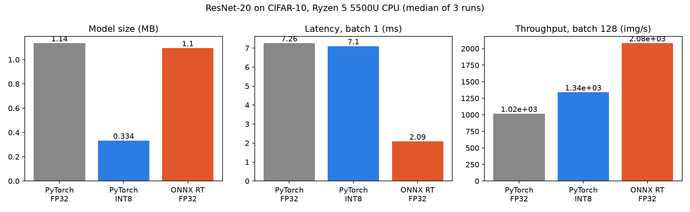
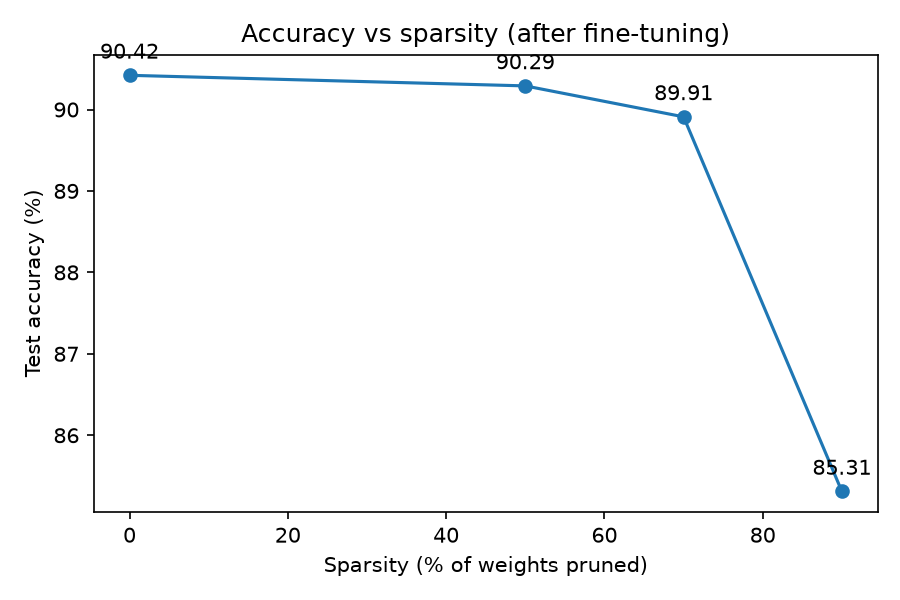

# CNN Inference Optimization: ResNet-20 on CIFAR-10

A ResNet-20 written from scratch in PyTorch and trained on CIFAR-10, then optimized for CPU inference with INT8 quantization, pruning, and ONNX Runtime. Every optimization is benchmarked for accuracy, model size, latency, and throughput on the same machine.

## Highlights

- **90.42%** test accuracy for the FP32 baseline (ResNet-20, 272,474 parameters, 30 epochs, trained on CPU).
- **INT8 post-training static quantization:** model size **−71%** (1.136 MB to 0.334 MB), batch throughput **+32%**, accuracy drop of only **0.04 points** (90.38%).
- **ONNX Runtime export:** batch-1 latency **3.5x lower** (7.26 ms to 2.09 ms) and throughput **2.05x higher**, with identical accuracy (90.42%) and output differences around 1e-6 versus PyTorch.
- **Global L1 pruning with fine-tuning:** **70%** of weights removed with a **0.51-point** accuracy drop (89.91%), and a **60%** smaller compressed (gzip) file.

## Results

Measured on an AMD Ryzen 5 5500U (6 cores), 16 GB RAM, Windows 11, Python 3.11, PyTorch 2.5.1 (CPU), ONNX Runtime 1.19.2. Latency is the median of 100 timed runs at batch size 1 (1 thread) after 20 warm-up runs. Throughput uses batch size 128 with 6 threads. Rows report the median over repeated runs (6 FP32, 5 INT8, 3 ONNX); other programs were closed during timing.

| Model | Accuracy (%) | Size (MB) | Latency bs=1 (ms) | Throughput (img/s) | Latency speed-up | Throughput gain |
|---|---|---|---|---|---|---|
| PyTorch FP32 | 90.42 | 1.136 | 7.26 | 1018 | 1.00x | 1.00x |
| PyTorch INT8 | 90.38 | 0.334 | 7.10 | 1341 | 1.02x | 1.32x |
| ONNX Runtime FP32 | 90.42 | 1.096 | 2.09 | 2083 | 3.48x | 2.05x |



### Pruning

Global unstructured L1 pruning on all Conv and Linear weights, followed by 3 epochs of fine-tuning (learning rate 0.01).

| Sparsity | Accuracy right after pruning (%) | Accuracy after fine-tuning (%) | Gzip size (MB) |
|---|---|---|---|
| 0% (dense) | 90.42 | 90.42 | 1.028 |
| 50% | 87.65 | 90.29 | 0.611 |
| 70% | 51.91 | 89.91 | 0.412 |
| 90% | 11.38 | 85.31 | 0.200 |



## Key takeaways

- **Quantization gave a clear size win at almost no accuracy cost.** INT8 stores 1 byte per weight instead of 4, so the file is about 3.4x smaller. Throughput improved by 32% at batch 128.
- **INT8 did not reduce batch-1 latency** (7.26 ms vs 7.10 ms, within run-to-run noise). ResNet-20 is tiny, so fixed per-layer overhead dominates at batch 1. The Ryzen 5500U also most likely lacks the VNNI instructions that make INT8 fast on newer CPUs.
- **ONNX Runtime gave the largest speed-up.** Graph optimizations (fusing Conv, BatchNorm, and ReLU, constant folding, memory planning) and optimized CPU kernels remove most of PyTorch's per-operation overhead at small batch sizes.
- **Pruning compresses the file but does not speed up inference.** Pruned weights are stored as zeros in dense FP32 tensors, so the file stays 1.136 MB and latency stays at about 7.3 to 7.6 ms. The benefit appears after compression (gzip). Real speed-ups would need structured pruning (removing whole channels) or sparse-aware kernels.
- **Fine-tuning is essential.** At 70% sparsity, accuracy fell to 51.91% right after pruning and recovered to 89.91% after only 3 epochs.

## Method

1. **Data (`data.py`):** CIFAR-10 with random crop (padding 4), horizontal flip, and per-channel normalization for training; normalization only for testing.
2. **Model (`model.py`):** ResNet-20 with BasicBlocks (two 3x3 convolutions, BatchNorm, skip connection, 1x1 convolution shortcut when the shape changes), three stages of 16, 32, and 64 channels, global average pooling, and a linear classifier.
3. **Training (`train.py`):** SGD (learning rate 0.1, momentum 0.9, weight decay 5e-4), cosine learning-rate schedule, 30 epochs, cross-entropy loss.
4. **Benchmarking (`benchmark.py`):** accuracy on the 10,000 test images, model file size, batch-1 latency (median and p95), and batch-128 throughput.
5. **Quantization (`quantize.py`):** layer fusion, calibration on 1,000 training images (no augmentation, no test data), and conversion to INT8 using the fbgemm backend.
6. **Pruning (`prune.py`):** global L1 unstructured pruning at 50%, 70%, and 90%, with fine-tuning and permanent mask removal.
7. **ONNX Runtime (`onnx_runtime.py`):** export with dynamic batch size, an output comparison against PyTorch, and benchmarking with graph optimizations enabled.
8. **Report (`report.py`):** builds the results table and charts.

## Reproduce

```bash
git clone https://github.com/AarushiDhoundiyal/cnn-inference-optimization.git
cd cnn-inference-optimization
python -m venv venv
venv\Scripts\activate
pip install torch==2.5.1 torchvision==0.20.1 --index-url https://download.pytorch.org/whl/cpu
pip install matplotlib numpy tqdm onnx onnxruntime==1.19.2

python train.py --epochs 30     # about 2 hours on a 6-core laptop CPU
python benchmark.py             # FP32 baseline
python quantize.py              # INT8 post-training quantization
python prune.py                 # pruning at 50%, 70%, 90%
python onnx_runtime.py          # ONNX export and benchmark
python gzip_baseline.py         # dense gzip size for the pruning comparison
python report.py                # table and charts
```

Raw benchmark numbers from every run are in `results_log.md`.

## Limitations

- Results come from a single training run (one seed), so differences of a few hundredths of a point in accuracy (such as 90.42% vs 90.38%) are not statistically meaningful.
- Timing was measured on one laptop CPU, and the numbers will differ on other hardware. Latency differences under about 2% are within run-to-run noise.
- Pruned models were fine-tuned for only 3 epochs, and the 90% model was still improving, so its accuracy is a lower bound.
- Quantization was post-training only. Quantization-aware training could narrow the remaining gap further.
- Pruning is unstructured, so it reduces compressed size but not compute.

## Possible next steps

- Structured (channel) pruning for real latency gains
- Quantization-aware training
- Static INT8 quantization inside ONNX Runtime
- Training on a GPU for a longer schedule to reach higher baseline accuracy
